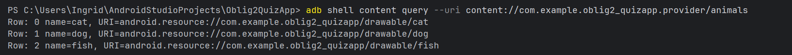
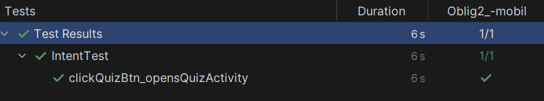
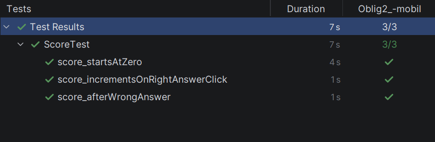
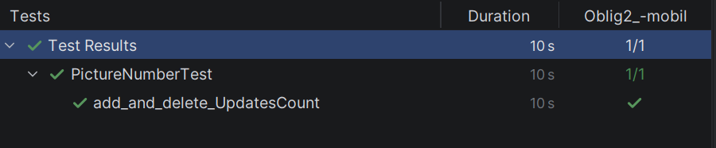

OBLIG 2 Quiz App

This app includes a gallery and a quiz. In the quiz the user need to select the correct animal name for the image. 
In the gallery the user can decide which photos to have. 

All the animals are stored in a Room database.

In task 2 I created a Provider-file with a class named QuizContentProvider.
This provider was tested using the Android Debug Bridge "adb". 

Screenshot of the output:

Then I made some tests to check that the application works as it should. 

IntentTest-class
Clicks on the Quizbutton in the main menu and then verifies that QuizActivity opens. 

ScoreTest-class
Verifies that the score is 0 when the app starts and that it increments correctly when user answer correct. When a user answer wrong it also tests that score goes back to value 0. 

PictureNumberTest
Verifies that number of items in Animal-list increases by 1 after adding a picture, and returns back to original after deleting. To do this I used intent stubbing to add an image without user interaction.

